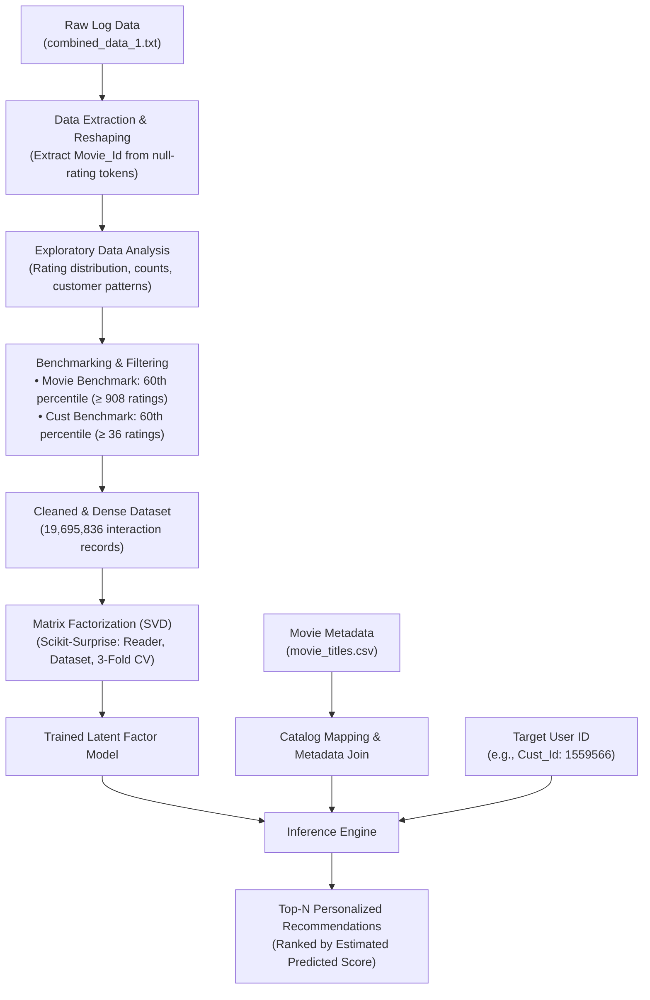

# 🎬 Netflix Movie Recommendation System

[](https://www.python.org/)
[](https://pandas.pydata.org/)
[](https://numpy.org/)
[](https://surpriselib.com/)
[](https://opensource.org/licenses/MIT)

> **A scalable, data-driven Collaborative Filtering recommendation engine built on the famous Netflix Prize dataset using Singular Value Decomposition (SVD) Matrix Factorization.**

---

## 📌 Table of Contents

- [Overview](#-overview)
- [Key Highlights](#-key-highlights)
- [System Architecture](#-system-architecture)
- [Dataset Overview](#-dataset-overview)
- [Data Preprocessing & Noise Reduction](#-data-preprocessing--noise-reduction)
- [Model Architecture & Training (SVD)](#-model-architecture--training-svd)
- [Evaluation & Experimental Results](#-evaluation--experimental-results)
- [Sample Recommendation Case Study](#-sample-recommendation-case-study)
- [Repository Structure](#-repository-structure)
- [Installation & Getting Started](#-installation--getting-started)
- [How to Run](#-how-to-run)
- [Future Roadmap](#-future-roadmap)
- [Author & Acknowledgments](#-author--acknowledgments)

---

## 📖 Overview

Modern on-demand streaming platforms such as **Netflix**, **Amazon Prime Video**, and **Disney+ Hotstar** rely heavily on recommendation engines to deliver hyper-personalized user experiences, optimize viewer engagement, and reduce catalog churn.

This project implements an end-to-end **Movie Recommendation System** using the historic **Netflix Prize Dataset**. It demonstrates the complete lifecycle of a production-grade machine learning pipeline:
1. Handling and reshaping raw, unindexed flat-file log data (>24 million records).
2. Exploratory Data Analysis (EDA) to understand customer rating behaviors.
3. Statistical thresholding (quantile filtering) to address the classic recommender system *data sparsity* and *cold-start* noise.
4. Latent factor modeling using **Singular Value Decomposition (SVD)** matrix factorization.
5. Personalized Top-$N$ movie recommendations tailored to individual customer preferences.

---

## 🚀 Key Highlights

- **Massive Scale**: Ingests and processes over **24,000,000 ratings** submitted by **470,758 unique users** across **4,499 movies**.
- **Data Engineering**: Solves irregular data structuring where movie IDs act as delimiters without native column indicators.
- **Noise & Sparsity Filtering**: Implements a robust 60th-percentile benchmark cut-off, retaining high-signal user interactions while trimming long-tail inactive users and rarely-rated movies.
- **Matrix Factorization**: Deploys the **SVD algorithm** from `scikit-surprise` to discover latent preferences across users and movies.
- **Validated Performance**: Achieves a cross-validated **Root Mean Squared Error (RMSE) of ~0.973** across 3 folds.

---

## 🏗 System Architecture

The recommendation pipeline follows a modular workflow from raw data ingestion to personalized inference:



---

## 📊 Dataset Overview

The project utilizes data sourced from the benchmark **Netflix Prize Challenge**:

| Component | File Name | Description |
| :--- | :--- | :--- |
| **User Ratings** | `combined_data_1.txt` | Flattened interaction log containing `Cust_Id`, `Rating`, and date strings. |
| **Movie Metadata** | `movie_titles.csv` | Catalog data containing `Movie_Id`, `Release_Year`, and `Movie_Name`. |

### Initial Raw Statistics
- **Total Rows Processed:** `24,058,263`
- **Total Unique Movies:** `4,499`
- **Total Unique Customers:** `470,758`
- **Total Ratings Logged:** `24,053,764`

### Rating Distribution Analysis

User ratings range between integer scores **1.0 (lowest)** to **5.0 (highest)**:

| Rating Stars | Number of Ratings | Percentage | Visual Share |
| :---: | :---: | :---: | :--- |
| ⭐ (1.0) | 1,118,186 | 4.65% | █ |
| ⭐⭐ (2.0) | 2,439,073 | 10.14% | ██ |
| ⭐⭐⭐ (3.0) | 6,904,181 | 28.70% | ██████ |
| ⭐⭐⭐⭐ (4.0) | **8,085,741** | **33.62%** | **███████ (Most Common)** |
| ⭐⭐⭐⭐⭐ (5.0) | 5,506,583 | 22.89% | █████ |

> **Insight:** User sentiment skews notably positive: over **56.5%** of all recorded interactions are 4 or 5 stars, while 1-star ratings constitute less than 5% of all feedback.

---

## 🧹 Data Preprocessing & Noise Reduction

### 1. Header Resolution & Reshaping
In `combined_data_1.txt`, movie IDs are represented as header rows with a trailing colon and no rating (e.g., `1:`, `NaN`), followed by hundreds of lines of user ratings.
- A parsing algorithm scans rows where ratings are `NaN`, extracts the movie ID, and propagates it down until the next movie header appears.
- Header rows are eliminated, and `Cust_Id` and `Movie_Id` are cast to standardized integer values.

### 2. Trimming the Long Tail (Quantile Benchmarking)
Recommender systems suffer from **data sparsity**; infrequent raters and obscure movies inject substantial variance and noise into collaborative filtering algorithms. To address this, statistical quantile cuts were applied:

```python
# Movie filtering: keep movies in the top 40% of rating frequency
movie_benchmark = dataset_movie_summary['count'].quantile(0.60) # 908 ratings threshold

# Customer filtering: keep users in the top 40% of activity
cust_benchmark = dataset_cust_summary['count'].quantile(0.60)   # 36 ratings threshold
```

- **Movies:** 2,699 movies receiving fewer than 908 ratings were removed (retaining 1,800 active titles).
- **Customers:** 282,042 users with fewer than 36 reviews were dropped.
- **Filtered Interactions:** The dataset was consolidated into a dense, high-signal matrix of **19,695,836 ratings**.

---

## 🧠 Model Architecture & Training (SVD)

### Theoretical Foundation
**Singular Value Decomposition (SVD)** under collaborative filtering factorizes the sparse User-Item interaction matrix $R$ into lower-dimensional latent spaces representing user affinities and item traits:

$$\hat{r}_{u,i} = \mu + b_u + b_i + q_i^T p_u$$

Where:
- $\mu$: Global baseline rating across all movies.
- $b_u$: Bias of user $u$ (whether they tend to rate harsher or more generously than average).
- $b_i$: Bias of movie $i$ (whether the movie generally receives higher or lower ratings than average).
- $q_i \in \mathbb{R}^k$: Latent factor vector representing movie characteristics.
- $p_u \in \mathbb{R}^k$: Latent factor vector representing user preferences.

Regularized squared error is minimized using **Stochastic Gradient Descent (SGD)**:

$$\min \sum_{u,i} \left( r_{u,i} - \hat{r}_{u,i} \right)^2 + \lambda \left( b_i^2 + b_u^2 + \|q_i\|^2 + \|p_u\|^2 \right)$$

---

## 📈 Evaluation & Experimental Results

The model was evaluated using **3-Fold Cross-Validation** on the interaction subset:

| Metric | Fold 1 | Fold 2 | Fold 3 | **Mean** |
| :--- | :---: | :---: | :---: | :---: |
| **Test RMSE** | 0.9737 | 0.9722 | 0.9731 | **0.9730** |
| **Fit Time (s)** | 42.28 | 38.53 | 43.67 | 41.49 |
| **Test Time (s)** | 11.70 | 10.21 | 13.87 | 11.93 |

An average RMSE of **0.9730** indicates that, on a scale of 1 to 5, the model's rating predictions deviate from actual user ratings by less than a single star point on unseen test folds.

---

## 🎯 Sample Recommendation Case Study

To test personalized inference, an active user was selected from the dataset:
- **Target User ID:** `1559566`
- **Historical Activity:** Rated **132** unique movies across various genres.

The recommendation engine scanned the candidate catalog, calculated latent factor dot products, and predicted the user's expected affinity score (`Estimate_Score`):

### Top 5 Recommended Movies for User 1559566

| Rank | Movie ID | Year | Title | Predicted Rating (`Estimate_Score`) |
| :---: | :---: | :---: | :--- | :---: |
| 🥇 | **215** | 1998 | **That '70s Show: Season 1** | **4.72 / 5.0** |
| 🥈 | **76** | 1952 | **I Love Lucy: Season 2** | **4.35 / 5.0** |
| 🥉 | **223** | 2003 | **Chappelle's Show: Season 1** | **4.34 / 5.0** |
| 4 | **209** | 1996 | **Star Trek: Deep Space Nine: Season 5** | **4.31 / 5.0** |
| 5 | **133** | 2003 | **Viva La Bam: Season 1** | **4.31 / 5.0** |

> **Evaluation:** The top recommendations reflect a strong affinity for episodic comedy series, sitcoms, and cult-classic franchises, demonstrating the model's ability to uncover multi-dimensional taste profiles.

---

## 📂 Repository Structure

```text
Netflix-Movie-Recommendation-System/
├── .git/                                         # Version control metadata
├── Netflix Movie Recommendation System.ipynb     # Complete Jupyter Notebook (EDA, preprocessing, SVD training, evaluation)
├── movie_titles.csv                              # Catalog metadata (ID, Year, Title)
└── README.md                                     # Project documentation
```

*(Note: Due to GitHub file size limits, the raw `combined_data_1.txt` rating file (~550 MB) is excluded from version control and can be downloaded separately.)*

---

## ⚙️ Installation & Getting Started

### 1. Clone the Repository
```bash
git clone https://github.com/ashwin0657/Netflix-Movie-Recommendation-System.git
cd Netflix-Movie-Recommendation-System
```

### 2. Set Up a Virtual Environment
```bash
# Windows (PowerShell)
python -m venv venv
venv\Scripts\Activate.ps1

# Linux / macOS
python3 -m venv venv
source venv/bin/activate
```

### 3. Install Dependencies
```bash
pip install pandas numpy matplotlib seaborn scikit-surprise notebook
```

### 4. Download Raw Dataset
Ensure `combined_data_1.txt` is placed in the project root directory. You can obtain it from the official [Kaggle Netflix Prize Dataset](https://www.kaggle.com/datasets/netflix-inc/netflix-prize-data).

---

## 💻 How to Run

1. Launch Jupyter Notebook:
   ```bash
   jupyter notebook
   ```
2. Open [`Netflix Movie Recommendation System.ipynb`](file:///c:/Users/Ashwin/OneDrive/Documents/assignments/Capstrone%20netflex%20project/Netflix%20Movie%20Recommendation%20System.ipynb).
3. Execute cells sequentially from top to bottom:
   - **Data Ingestion & Cleaning**: Extracts `Movie_Id` and verifies data completeness.
   - **EDA**: Generates rating distribution plots.
   - **Trimming**: Filters out sparse records.
   - **Modeling**: Fits the SVD algorithm and computes RMSE.
   - **Inference**: Pass any target `Cust_Id` to generate personalized recommendations.

---

## 🚀 Future Roadmap

- [ ] **Hybrid Recommender System**: Integrate content-based filtering (TF-IDF on movie overviews, director, genres, and cast) to resolve cold-start issues for brand-new movies.
- [ ] **Deep Learning Models**: Benchmark against **Neural Collaborative Filtering (NCF)**, **AutoRec**, and **Two-Tower Neural Architectures**.
- [ ] **Interactive Web Interface**: Build an interactive web dashboard with **Streamlit** or **FastAPI + React** allowing users to select movies, rate them in real-time, and view instant recommendations.
- [ ] **Implicit Feedback Modeling**: Incorporate watch-time duration, search queries, and skip rates to simulate implicit user signals.

---

## 👨‍💻 Author & Acknowledgments

- **Author:** Ashwin Vishwakarma
- **GitHub:** [@ashwin0657](https://github.com/ashwin0657)
- **Project Type:** Capstone Machine Learning Project

### References & Acknowledgments
- [Netflix Prize Challenge](https://www.netflixprize.com/)
- [Scikit-Surprise Documentation](https://surpriselib.com/)
- Koren, Y., Bell, R., & Volinsky, C. (2009). *Matrix Factorization Techniques for Recommender Systems*. Computer, 42(8), 30-37.
